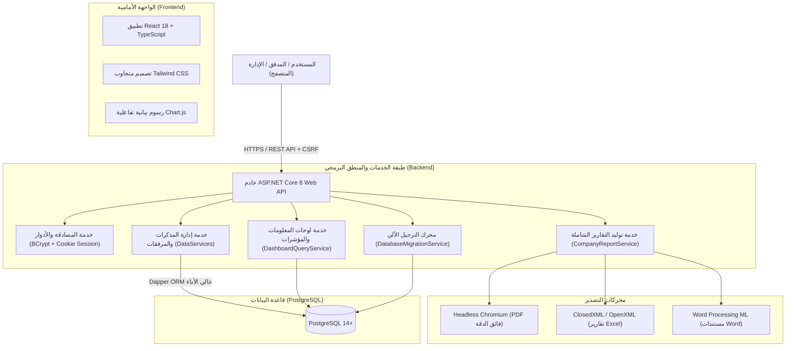
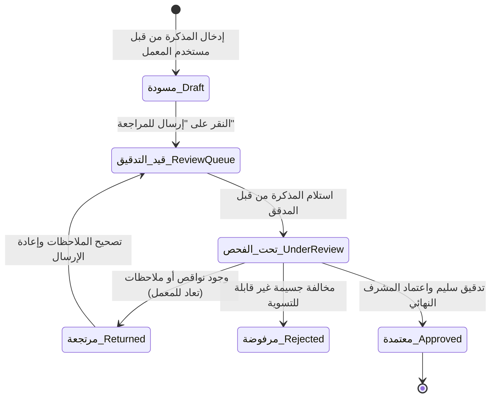

# دليل المنظومة وهندسة المشروع وميزاته الفنية — نظام المذكرات والرقابة الصناعية (MemoDashboard 2.0.2)

## 1. نبذة عامة عن المنظومة والهدف الوظيفي

منظومة **MemoDashboard (نظام تدقيق المذكرات والرقابة والتفتيش الصناعي)** هي منصة مركزية متكاملة مصممة لإدارة وتدقيق ومتابعة المذكرات الرسمية وسجلات حركة المواد والمنتجات عبر كافة المنشآت الصناعية والمعامل وخطوط الإنتاج التابعة للشركات والمؤسسات المركزية.

### الهدف الرئيسي
* **الرقابة والتفتيش الصناعي:** إحكام الرقابة على تداول المواد الخام، المنتجات النهائية، ومذكرات الإدخال والإخراج والتحويل، ومنع أي تلاعب أو فقدان للوثائق.
* **التحول الرقمي والأتمتة:** استبدال الدورة المستندية الورقية التقليدية بنظام إلكتروني لحظي يدعم الأرشفة الرقمية للوثائق والمرفقات الأصلية.
* **التدقيق المالي والتشغيلي:** حصر المخالفات والأخطاء الفنية والإجرائية في المذكرات عبر مؤشرات تدقيق دقيقة ومصنفة (مخالفات جوهرية، شكلية، حسابية، إجرائية).
* **دعم اتخاذ القرار:** توفير لوحات معلومات إحصائية فورية (Executive Dashboards) وتقارير دورية موحدة تقيس كفاءة المصانع ومعدلات الإنجاز وأزمنة التأخير.

---

## 2. المعمارية الفنية والتقنيات (Architecture & Technology Stack)

تم بناء المنظومة وفق معمارية حديثة وموثوقة تفصل بين واجهات المستخدم وخدمات الخادم وقواعد البيانات، مع الالتزام بأعلى معايير الأداء والأمان:

### المكونات الرئيسية للمنظومة
1. **الواجهة الأمامية (Modern Single-Page Application):**
   * مبنية باستخدام **React 18** مع **TypeScript** لضمان استقرار الأنماط البرمجية وخلوها من الأخطاء أثناء التطوير.
   * إطار التنسيق الحديث **Tailwind CSS** مع دعم كامل للاتجاه من اليمين لليسار (`dir="rtl"`) والوضع الليلي/النهاري (Dark/Light Mode).
   * رسوم بيانية ديناميكية عبر مكتبة **Chart.js** لمتابعة المؤشرات والنسب المئوية لحالات المذكرات.
2. **الباك إند (High-Performance Backend):**
   * إطار العمل **ASP.NET Core 8 (LTS)** باستخدام الـ Minimal Endpoints والـ Controllers المهيكلة.
   * استخدام **Dapper Micro-ORM** لتنفيذ استعلامات SQL ذات الأداء العالي جداً مع تفادي حمل الـ Overhead الخاص بـ Entity Framework في التقارير الضخمة.
   * تشفير كلمات المرور باستخدام خوارزمية التشفير المتطورة **BCrypt**.
   * حماية صارمة ضد هجمات تزوير الطلبات عبر المواقع **Antiforgery (CSRF)** مع توثيق الجلسات بملفات تعريف الارتباط المشفرة (Encrypted HTTP-Only Cookies).
3. **محرك التقارير متعدد الصيغ (Multi-Format Reporting Engine):**
   * **تقارير PDF خادمية:** توليد تقارير رسمية فائقة الجودة عبر محرك **Headless Chromium** الداخلي، مما يضمن التشكيل العربي السليم 100% والمطابقة الكاملة لتخطيط الصفحة (A4 Landscape/Portrait) مع الخطوط المعتمدة (`ITF Qomra Arabic` و `Simplified Arabic`).
   * **تقارير Excel تفاعلية:** بناء جداول بيانات غنية بالمعادلات والألوان والتنسيقات الرسمية المتوافقة مع Microsoft Excel.
   * **مستندات Word:** توليد ملفات DOCX رسمية قابلة للتحرير المكتبي.
4. **محرك الترحيل الذاتي لقاعدة البيانات (Self-Healing Migration Engine):**
   * نظام ترحيل تلقائي مدمج (`DatabaseMigrationService`) يفحص حالة قاعدة البيانات عند بدء التشغيل ويطبق التحديثات من السكربت 001 حتى 070 تلقائياً داخل معاملات ذرية آمنة (Atomic Transactions).

---

## 3. هيكلية المشاريع البرمجية في الكود المصدري

تم تقسيم الشيفرة المصدرية إلى مشاريع منفصلة ومترابطة بدقة ضمن الحل `AuditMemoSystem.sln`:

| المشروع | المسار | الوظيفة |
| :--- | :--- | :--- |
| **`AuditMemoSystem.Core`** | `source/src/AuditMemoSystem.Core` | النماذج الأساسية للكيانات (Entities)، العقود (Interfaces)، وقواعد التحقق ومنطق الأعمال الأساسي. |
| **`AuditMemoSystem.Data`** | `source/src/AuditMemoSystem.Data` | مستودعات البيانات (Repositories)، خدمات الاتصال بـ PostgreSQL، ومنطق الاستعلامات المباشر `DataServices.cs`. |
| **`MemoDashboard.Backend`** | `source/src/MemoDashboard.Web/Backend` | خادم الويب الأساسي، نقاط النهاية (Endpoints)، خدمات المصادقة، خدمة التقارير، وإعدادات الخدمة. |
| **`MemoDashboard.Frontend`** | `source/src/MemoDashboard.Web/Frontend` | تطبيق الويب المستقل (React/Vite/TSX) المترجم تلقائياً إلى مجلد `wwwroot`. |
| **`MemoUpdateContracts`** | `source/src/MemoUpdateContracts` | عقود التحديث والأمان والتوقيع الرقمي للمنظومة. |
| **مشاريع الاختبارات** | `source/tests/*` | حزم الاختبارات الآلية (Core Tests, Backend Tests, Frontend Vitest). |

---

## 4. نموذج البيانات وهيكل الجداول الرئيسية (Database Schema)

تعتمد المنظومة على مخطط بيانات متكامل وقوي في PostgreSQL يضمن التكامل المرجعي (Foreign Keys) مع فهارس أداء ذكية (Covering Indexes):

* **`notes` (جدول المذكرات الأساسي):** يحوي رقم المذكرة، تاريخ الورود، تاريخ الكتابة، الشركة، المعمل، خط الإنتاج، الحالة (مسودة، قيد التدقيق، معتمدة، إلخ)، نص الموضوع، الملاحظات، وبيانات التدقيق.
* **`note_attachments` (جدول المرفقات المتعددة):** يخزن الوثائق والمستندات والصور والـ PDF المرفقة بكل مذكرة مع دعم التخزين الآمن وتتبع أحجام الملفات وأنواعها.
* **`note_links` (جدول ربط المذكرات):** يدعم الربط الشبكي المتعدد بين المذكرات المختلفة (ربط مذكرة إدخال بمذكرة إخراج أو تسليم غنائم أو فواتير) لمنع التكرار وتتبع مسار المواد.
* **`companies` & `factories` & `production_lines` (البيانات الهيكلية):** البنية التنظيمية للشركات التابعة والمعامل وخطوط الإنتاج، مع الحفاظ على البيانات التاريخية حتى لو تم تعطيل خط إنتاج معين.
* **`indicator_definitions` & `indicator_error_classes`:** المؤشرات المعيارية للتدقيق والتفتيش وتصنيف الأخطاء (أخطاء جسيمة، شكلية، تنظيمية).
* **`users` & `user_roles`:** جدول المستخدمين المشفر وربطهم بالأدوار والصلاحيات.
* **`audit_logs`:** سجل رقابي غير قابل للتعديل يوثق كل عملية (إنشاء، تعديل، حذف، اعتماد، تغيير حالة) مع هوية المستخدم والوقت الدقيق.

---

## 5. الأدوار والصلاحيات في المنظومة (Role-Based Access Control)

| الدور | الاسم في النظام | الصلاحيات الوظيفية |
| :--- | :--- | :--- |
| **مدير النظام العام** | `ADMIN` | * كامل الصلاحيات دون قيود. * إدارة المستخدمين وحساباتهم وكلمات المرور. * إدارة وتعديل الشركات والمعامل وخطوط الإنتاج ومؤشرات التدقيق. * حذف وتعديل المذكرات نهائياً، وتفريغ أو استعادة البيانات. * الاطلاع على كامل اللوحات الإحصائية والتقارير. |
| **المشرف / المدقق العام** | `SUPERVISOR` | * مراجعة طابور المذكرات الواردة (Review Queue). * اتخاذ قرارات الاعتماد النهائي للمذكرات أو إرجاعها للتعديل مع بيان السبب. * تصدير التقرير المقارن الشامل للشركات (PDF/Excel/Word). * متابعة مؤشرات الأداء ومعدلات إنجاز المدققين. |
| **المدقق** | `AUDITOR` | * فحص وتدقيق المذكرات الواردة واحتساب قيم المؤشرات والمخالفات. * كتابة تقارير التدقيق وإبداء الملاحظات. * رفع المذكرات للمشرف بعد التدقيق. |
| **مستخدم المعمل / مدخل البيانات** | `FACTORY_USER` | * تسجيل المذكرات الجديدة (إدخال/إخراج/تحويل). * رفع المرفقات والوثائق والصور الخاصة بالمذكرة. * تعديل المذكرات الخاصة به طالما أنها في حالة مسودة (Draft) أو مرتجعة (Returned). * متابعة حالة مذكرات المعمل الخاص به فقط. |

---

## 6. دورة حياة المذكرة وإجراءات العمل (Workflow)

### الميزات الذكية في التعامل مع المذكرات
1. **معاينة المرفقات المباشرة (In-Browser Preview):** إمكانية استعراض صور الوثائق وملفات PDF مباشرة داخل نافذة منبثقة تفاعلية في المتصفح مع أدوات التكبير والتدوير والطباعة دون الحاجة لتنزيل الملف على جهاز المستخدم.
2. **الربط الشبكي المتعدد (Multi-Link):** ربط أي مذكرة بمذكرات سابقة أو لاحقة (مثلاً ربط مذكرة استلام مواد بمذكرة تسليم غنائم أو فاتورة شراء سابقة) مع عرض بطاقات المذكرات المرتبطة بنقرة زر وتفادي الحلقات المغلقة (Circular Dependencies).
3. **التحقق من تكرار المذكرات (Duplicate Detection):** فحص تلقائي يمنع تسجيل مذكرات بنفس الرقم لنفس المعمل في نفس السنة أو التنبيه عند تشابه محتويات المذكرات.
4. **تتبع مذكرات الغنائم والفواتير:** تخصيص علامات وحقول محددة لمذكرات استلام ونقل الغنائم والمواد المستردة لضمان دقة الرقابة الصناعية والقانونية عليها.

---

## 7. لوحات القيادة والتقارير التنفيذية (Dashboards & Reports)

1. **اللوحة الحية الفورية (Live Operational Dashboard):**
   * عدادات إجمالية لحظية: إجمالي المذكرات، المذكرات المعتمدة، قيد التدقيق، المرتجعة، ونسب الإنجاز.
   * مؤشرات أزمنة الانتظار ومعدلات التأخير في معالجة المذكرات بالأيام والساعات.
2. **التقرير الموحد المقارن للشركات (Company Comparison Report):**
   * جدول تحليلي ضخم يقارن بين كافة الشركات والمعامل وخطوط الإنتاج.
   * إحصائيات دقيقة لمؤشرات التدقيق، الأخطاء، المذكرات غير المربوطة، وتوزيع مذكرات الإدخال والإخراج.
   * تصدير فوري بثلاث صيغ:
     * **PDF:** تصميم رسمي بختم وشعار الجمهورية العربية السورية، مجهز للطباعة الفورية قياس A4 Landscape.
     * **Excel:** جداول منسقة بدقة وجاهزة للتحليل المالي والإحصائي.
     * **Word:** مستند رسمي قابل للتعديل والطباعة.

